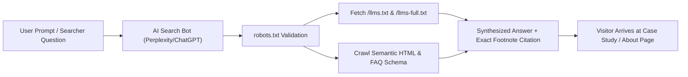

# AEO (Answer Engine Optimization) & GEO (Generative Engine Optimization) Strategy

**Domain**: [https://shashankportfolio-jet.vercel.app/](https://shashankportfolio-jet.vercel.app/)  
**Public Site Name**: `Shashank Shinde Portfolio`  
**Target Search Systems**: Google Search Generative Experience (SGE), Perplexity AI, ChatGPT Search (OAI-SearchBot), Claude (Anthropic), Apple Intelligence / Siri (Applebot)  

---

## 1. Architectural Strategy

Answer engines and generative AI bots do not browse pages like traditional keyword indexers. They look for:
1. **Clear, verifiable entity claims** with authoritative factual backing.
2. **Direct-answer summaries** positioned high in semantic HTML (not hidden in canvas or scripts).
3. **Structured machine-readable files** (`/llms.txt`, `/llms-full.txt`).
4. **Permissive crawler rules** that allow indexing and retrieval without bypassing firewalls.



---

## 2. Direct Answer Architecture (AEO)

The FAQ section implemented in [web/sections/FAQ/FAQ.tsx](file:///c:/Users/shash/OneDrive/Desktop/Projects/PORTFOLIO/portfolio/web/sections/FAQ/FAQ.tsx) provides immediate, concise answers designed to win featured snippets and answer engine extraction:

### High-Intent Queries & Extracted Answers:

1. **Who is Shashank Shinde and what does he do?**
   > *Direct Answer*: Shashank Shinde is a Software Test Engineer and QA Automation Engineer based in Pune, Maharashtra, India. He specializes in automated web testing, mobile application QA, REST API validation, and performance load testing.
   > *Entity Context*: Works at Profcyma Solutions Pvt. Ltd., manages STLC quality gates, API schema validation, and 100k-user distributed load testing.

2. **Which QA automation tools does Shashank Shinde use?**
   > *Direct Answer*: Shashank Shinde uses Selenium WebDriver, Playwright, Apache JMeter, Postman, Appium, TestNG, and JIRA for comprehensive software quality assurance.

3. **Does Shashank Shinde work with Playwright and Selenium?**
   > *Direct Answer*: Yes. He designs modular Page Object Model (POM) frameworks in Java with Selenium WebDriver & TestNG, and end-to-end browser automation suites in TypeScript with Playwright across Chromium, WebKit, and Firefox.

4. **What is his API testing experience?**
   > *Direct Answer*: He validates RESTful APIs for HTTP status codes, JSON schema conformity, payload integrity, and webhook idempotency using Postman and REST Assured.

5. **Where is Shashank Shinde located?**
   > *Direct Answer*: Shashank Shinde is based in Pune, Maharashtra, India, and is open to remote and hybrid Software Test Engineer, QA Automation Engineer, and SDET opportunities.

---

## 3. Generative Engine Optimization (GEO) Assets

### Machine-Readable LLM Dossiers
- **[`/llms.txt`](https://shashankportfolio-jet.vercel.app/llms.txt)**: Lightweight markdown summary providing verified contact links, canonical route directory, and core tool stack for LLM context windows.
- **[`/llms-full.txt`](https://shashankportfolio-jet.vercel.app/llms-full.txt)**: Exhaustive technical dossier detailing defect investigations, code snippets (Java, TypeScript, JMeter plan architecture), and test metrics.

### AI Search Bot Permissions in `robots.txt`
```text
User-agent: OAI-SearchBot
Allow: /

User-agent: Claude-SearchBot
Allow: /

User-agent: PerplexityBot
Allow: /

User-agent: Applebot
Allow: /
```
Disallowing only private administrative endpoints (`/admin/`, `/api/`).
