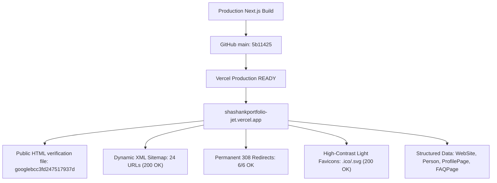

# Final SEO Implementation & Launch Report

**Public Site Name**: `Shashank Shinde Portfolio`  
**Production Domain**: [https://shashankportfolio-jet.vercel.app/](https://shashankportfolio-jet.vercel.app/)  
**Owner & Engineer**: Shashank Shinde  
**Date**: November 22, 2026  
**Status** ? Technical changes deployed. See [Current verification](VERIFICATION.md) for evidence and account actions.

---

## 1. Executive Summary & Verification Summary

The reports below describe the implementation and its historical checks. The current verification records public production checks, platform responses and remaining account actions.

---

## 2. Deliverables Index

All 10 requested technical SEO documentation files have been produced and organized in `portfolio/docs/seo/`:

1. [SEO_INITIAL_AUDIT.md](file:///c:/Users/shash/OneDrive/Desktop/Projects/PORTFOLIO/portfolio/docs/seo/SEO_INITIAL_AUDIT.md): Complete audit across 25 public URLs, status codes, and issue prioritization.
2. [KEYWORD_RESEARCH.md](file:///c:/Users/shash/OneDrive/Desktop/Projects/PORTFOLIO/portfolio/docs/seo/KEYWORD_RESEARCH.md): Brand queries, role-based terms, long-tail problem-solution mapping, and cannibalization prevention.
3. [COMPETITOR_ANALYSIS.md](file:///c:/Users/shash/OneDrive/Desktop/Projects/PORTFOLIO/portfolio/docs/seo/COMPETITOR_ANALYSIS.md): QA/SDET portfolio benchmark analysis, quadrant positioning, and SERP differentiators.
4. [TECHNICAL_SEO_REPORT.md](file:///c:/Users/shash/OneDrive/Desktop/Projects/PORTFOLIO/portfolio/docs/seo/TECHNICAL_SEO_REPORT.md): App Router metadataBase, canonicals, 308 redirects, XML sitemap, and verification tags.
5. [ON_PAGE_SEO_REPORT.md](file:///c:/Users/shash/OneDrive/Desktop/Projects/PORTFOLIO/portfolio/docs/seo/ON_PAGE_SEO_REPORT.md): Semantic heading hierarchy (H1-H3), image alt text pipeline, and internal linking structure.
6. [AEO_GEO_REPORT.md](file:///c:/Users/shash/OneDrive/Desktop/Projects/PORTFOLIO/portfolio/docs/seo/AEO_GEO_REPORT.md): Direct answer FAQ architecture, AI crawler permissions, and machine-readable `/llms.txt`.
7. [BACKLINK_STRATEGY.md](file:///c:/Users/shash/OneDrive/Desktop/Projects/PORTFOLIO/portfolio/docs/seo/BACKLINK_STRATEGY.md): White-hat off-page authority building, technical community participation, and profile consistency.
8. [PERFORMANCE_REPORT.md](file:///c:/Users/shash/OneDrive/Desktop/Projects/PORTFOLIO/portfolio/docs/seo/PERFORMANCE_REPORT.md): Core Web Vitals audit (LCP, INP, CLS), self-hosted WOFF2 fonts, and responsive WebP media.
9. [MCP_INTEGRATION_STATUS.md](file:///c:/Users/shash/OneDrive/Desktop/Projects/PORTFOLIO/portfolio/docs/seo/MCP_INTEGRATION_STATUS.md): Semrush plugin, Google Developer Knowledge MCP, Search Console integration, and authentication guides.
10. [FINAL_SEO_IMPLEMENTATION_REPORT.md](file:///c:/Users/shash/OneDrive/Desktop/Projects/PORTFOLIO/portfolio/docs/seo/FINAL_SEO_IMPLEMENTATION_REPORT.md): This comprehensive final implementation and launch report.

---

## 3. Owner Actions Required

To complete account-level indexing and search tracking:

1. **Google Search Console**:
   - Access: [Search Console Property](https://search.google.com/search-console?resource_id=https://shashankportfolio-jet.vercel.app/)
   - Verify ownership: Use the HTML file verification method in this URL-prefix property. The public file is available and ownership still needs dashboard confirmation.
   - Submit Sitemap: Enter `sitemap.xml` under Sitemaps and click Submit.
   - Request Indexing: In URL Inspection, enter `https://shashankportfolio-jet.vercel.app/` and click "Request Indexing".
2. **Semrush Plugin (Optional Power Tool)**:
   - Add the Semrush plugin from the provided UI card in Antigravity to connect your Semrush account for live keyword and backlink tracking.
3. **Google Developer Knowledge Plugin (Optional Reference)**:
   - Add the Google Developer Knowledge plugin to query Search Central documentation directly inside Antigravity.
