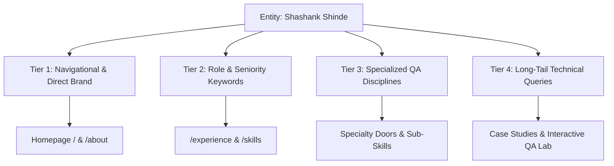

# Keyword Research & Personal Brand Positioning

**Public Entity**: Shashank Shinde — Software Test Engineer & QA Automation Engineer  
**Location**: Pune, Maharashtra, India  
**Target Domain**: [https://shashankportfolio-jet.vercel.app/](https://shashankportfolio-jet.vercel.app/)  
**Document Purpose**: Define search intent, query tiers, cannibalization prevention, and keyword-to-page architecture.

---

## 1. Brand Identity & Primary Keyword Strategy

Personal brand positioning focuses on establishing high domain authority and rich entity recognition across Google Search, Bing, and AI search engines (Perplexity, ChatGPT Search, Claude).

---

## 2. Keyword Classification & Intent Mapping

| Keyword Query | Intent | Target Page | Content Focus |
| :--- | :--- | :--- | :--- |
| **Shashank Shinde** | Navigational | `/` (Homepage) | Core entity identity, portfolio intro, links to work |
| **Shashank Shinde Portfolio** | Navigational | `/` (Homepage) | Official showcase, featured defect highlights |
| **Shashank Shinde QA Automation Engineer** | Informational / Commercial | `/about` | Career history, SDET certification, testing approach |
| **Shashank Shinde Software Tester** | Informational | `/about` | STLC methodology, manual & automation balance |
| **QA Automation Engineer Portfolio** | Commercial Investigation | `/projects` | Case studies, test frameworks, engineering ROI |
| **Software Test Engineer Portfolio** | Commercial Investigation | `/skills` | Complete toolstack, CI/CD, JMeter, Playwright, Selenium |
| **Automation Tester Pune** | Localized Commercial | `/contact` & `/about` | Pune location entity, availability for contract/hire |
| **Selenium WebDriver Automation** | Technical Informational | `/skills/selenium-automation` | Java, TestNG, Page Object Model, parallel execution |
| **Playwright Automation Testing** | Technical Informational | `/skills/playwright-automation` | TypeScript, auto-wait, isolated BrowserContexts |
| **Appium Mobile Testing Portfolio** | Technical Informational | `/skills/mobile-testing` | Android physical devices, touch gestures, APK flows |
| **REST API Testing Portfolio** | Technical Informational | `/skills/api-testing` | Postman, REST Assured, HMAC webhooks, JSON schema |
| **Apache JMeter Performance Testing** | Technical Informational | `/skills/performance-testing` | 100k concurrency, thread groups, latency SLA |

---

## 3. Long-Tail & Problem-Solution Queries (AEO/GEO Targets)

High-intent technical searchers (Engineering Managers, QA Leads, Recruiters) often search for specific problem-solving capability:

1. **"JMeter PostgreSQL connection pool exhaustion test"**  
   - *Target*: [`/projects/driwe-qa-case-study`](https://shashankportfolio-jet.vercel.app/projects/driwe-qa-case-study)
   - *Evidence*: Isolated DB connection limit crash prior to DRIWE flash sale launch.
2. **"E-commerce cart price cache desynchronization bug"**  
   - *Target*: [`/projects/grosido-qa-case-study`](https://shashankportfolio-jet.vercel.app/projects/grosido-qa-case-study)
   - *Evidence*: 638 test cases, discovered cart total price caching drift in Grosido.
3. **"Payment webhook double-deduction refund race condition"**  
   - *Target*: [`/projects/ecommerce-testing-case-study`](https://shashankportfolio-jet.vercel.app/projects/ecommerce-testing-case-study)
   - *Evidence*: Multi-role marketplace testing, identified webhook replay flaw.
4. **"Ride-sharing concurrent seat reservation race condition"**  
   - *Target*: [`/projects/ride-sharing-testing-case-study`](https://shashankportfolio-jet.vercel.app/projects/ride-sharing-testing-case-study)
   - *Evidence*: Pessimistic locking validation for 22 REST endpoints.
5. **"Android rapid multi-tap duplicate lead submission defect"**  
   - *Target*: [`/projects/urban-build-testing-case-study`](https://shashankportfolio-jet.vercel.app/projects/urban-build-testing-case-study)
   - *Evidence*: Debounce and idempotency testing under slow 3G latency.

---

## 4. Cannibalization Prevention Guidelines

To prevent keyword self-cannibalization between pages:
- **Brand Name + "Portfolio"**: Strictly owned by the canonical homepage `/`.
- **Bio, Education & Credentials**: Strictly owned by `/about`.
- **Framework Implementations**: Distributed to dedicated sub-skill pages (`/skills/selenium-automation`, `/skills/playwright-automation`, etc.).
- **Defect Deep Dives**: Distributed to individual case study URLs with clear, unique H1 headings.
