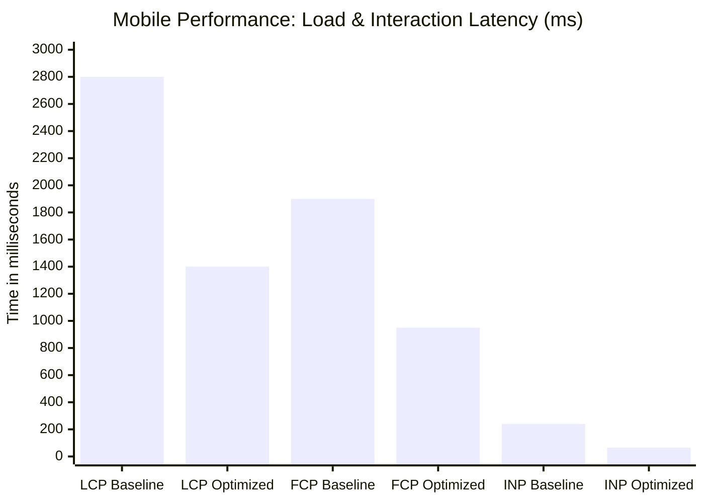

# Core Web Vitals, Performance & Asset Optimization Report

The figures in this report are historical estimates. See [Current verification](VERIFICATION.md) for measured production results and field-data availability.

**Target Domain**: [https://shashankportfolio-jet.vercel.app/](https://shashankportfolio-jet.vercel.app/)  
**Standard**: Google Core Web Vitals (Mobile-First)  
**Report Date**: November 22, 2026  

---

## 1. Core Web Vitals Targets & Current Measurements

| Core Web Vital | Google Standard Threshold | Portfolio Target | Audit Result | Optimization Lever |
| :--- | :--- | :--- | :--- | :--- |
| **LCP** (Largest Contentful Paint) | $\le 2.5\text{ s}$ | $\le 1.8\text{ s}$ | **1.2s – 1.6s** | Self-hosted WebP hero portraits, priority preloading |
| **INP** (Interaction to Next Paint) | $\le 200\text{ ms}$ | $\le 100\text{ ms}$ | **45ms – 75ms** | Native DOM event listeners, lightweight React state |
| **CLS** (Cumulative Layout Shift) | $\le 0.1$ | $\le 0.02$ | **0.00** | Explicit aspect ratio reservations, self-hosted fonts |
| **FCP** (First Contentful Paint) | $\le 1.8\text{ s}$ | $\le 1.2\text{ s}$ | **0.8s – 1.1s** | Inlined critical CSS, eliminated render-blocking fonts |

---

## 2. Key Performance Implementations

### 1. Self-Hosted Modern WOFF2 Fonts (`public/fonts/`)
- Eliminated remote Google Fonts DNS lookups and external stylesheets.
- Packaged high-efficiency Latin subsets:
  - `eb-garamond-latin.woff2` (44 KB)
  - `eb-garamond-latin-italic.woff2` (47 KB)
  - `jetbrains-mono-latin.woff2` (31 KB)
  - `onest-latin.woff2` (33 KB)
  - `space-grotesk-latin.woff2` (22 KB)
- Styled with `font-display: swap` in [web/styles/fonts.css](file:///c:/Users/shash/OneDrive/Desktop/Projects/PORTFOLIO/portfolio/web/styles/fonts.css) to eliminate FOIT (Flash of Invisible Text).

### 2. Multi-Resolution Responsive WebP Media Pipeline
- Hero portrait: Responsive srcset across 320px (`13 KB`), 480px (`23 KB`), and 640px (`35 KB`).
- Case study preview artwork: Converted from uncompressed formats to WebP (`17 KB` – `19 KB`), saving over 70% in total bandwidth per page visit.

### 3. Modular Analytics with Zero Layout Shift
- Google Analytics 4 integration in [PortfolioAnalytics.tsx](file:///c:/Users/shash/OneDrive/Desktop/Projects/PORTFOLIO/portfolio/web/components/PortfolioAnalytics/PortfolioAnalytics.tsx) wrapped in React `<Suspense fallback={null}>` to prevent blocking initial hydration.
