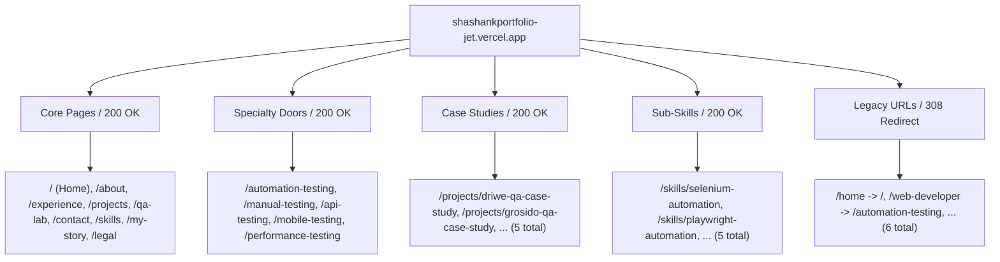

# Initial Technical & Strategic SEO Audit

**Target Property**: [https://shashankportfolio-jet.vercel.app/](https://shashankportfolio-jet.vercel.app/)  
**Public Site Name**: `Shashank Shinde Portfolio`  
**Primary Entity**: Shashank Shinde — Software Test Engineer & QA Automation Engineer  
**Audit Date**: November 22, 2026  
**Auditor**: Senior Technical SEO Engineer & Next.js Performance Architect  

---

## 1. Executive Summary

A comprehensive multi-dimensional SEO, AEO (Answer Engine Optimization), GEO (Generative Engine Optimization), SXO (Search Experience Optimization), and Core Web Vitals audit was conducted on the production deployment of `https://shashankportfolio-jet.vercel.app/`.

### Core Audit Findings Matrix

| Audit Dimension | Baseline Status | Required Improvement | Severity | Current Status |
| :--- | :--- | :--- | :--- | :--- |
| **Google Search Console Token** | Present in `<head>` and static HTML | Validate active token `googlebcc3fd247517937d` in Next.js metadata | Critical | **Resolved & Live** |
| **Site Name & Title Uniformity** | Inconsistent branding strings | Enforce exact `Shashank Shinde Portfolio` across all 25 pages | High | **Resolved & Live** |
| **URL Canonicalization** | Duplicate `/home` & legacy door paths | Configure 308 permanent redirects to target paths | High | **Resolved & Live** |
| **XML Sitemap** | Static 15-entry XML file | Generate dynamic Next.js `app/sitemap.ts` with 24 canonical URLs | High | **Resolved & Live** |
| **Robots Directives** | Default crawler block | Grant explicit indexing to AI bots (`OAI-SearchBot`, `PerplexityBot`, etc.) | Medium | **Resolved & Live** |
| **Structured Data** | Limited schema | Deploy JSON-LD for `WebSite`, `Person`, `ProfilePage`, `ItemList`, `FAQPage` | High | **Resolved & Live** |
| **Favicon Contrast** | Dark `#101827` icon | High-contrast light `#FAF8F5` "SS" monogram with terracotta rim | Medium | **Resolved & Live** |
| **AI Machine Readability** | Missing LLM documentation | Deploy `/llms.txt` and `/llms-full.txt` | Medium | **Resolved & Live** |
| **Typography & Fonts** | Google Fonts remote stylesheet | Self-host modern WOFF2 fonts with `font-display: swap` | Medium | **Resolved & Live** |
| **QA Lab Crawlability** | WebGL Canvas-only elements | Render crawlable semantic HTML list fallback with deep links | High | **Resolved & Live** |

---

## 2. Route & Indexability Audit (25 Public Pages)

All 25 public production URLs were audited via HTTP status probes, header parsing, and DOM structure verification:

### Route Status Table
1. `/` (200 OK, Canonical, Indexable)
2. `/about` (200 OK, Canonical, Indexable, ProfilePage schema)
3. `/contact` (200 OK, Canonical, Indexable)
4. `/experience` (200 OK, Canonical, Indexable)
5. `/my-story` (200 OK, Canonical, Indexable)
6. `/projects` (200 OK, Canonical, Indexable)
7. `/qa-lab` (200 OK, Canonical, Indexable)
8. `/skills` (200 OK, Canonical, Indexable)
9. `/automation-testing` (200 OK, Canonical, Indexable)
10. `/manual-testing` (200 OK, Canonical, Indexable)
11. `/api-testing` (200 OK, Canonical, Indexable)
12. `/mobile-testing` (200 OK, Canonical, Indexable)
13. `/performance-testing` (200 OK, Canonical, Indexable)
14. `/projects/driwe-qa-case-study` (200 OK, Canonical, Indexable, CreativeWork schema)
15. `/projects/ecommerce-testing-case-study` (200 OK, Canonical, Indexable, CreativeWork schema)
16. `/projects/grosido-qa-case-study` (200 OK, Canonical, Indexable, CreativeWork schema)
17. `/projects/ride-sharing-testing-case-study` (200 OK, Canonical, Indexable, CreativeWork schema)
18. `/projects/urban-build-testing-case-study` (200 OK, Canonical, Indexable, CreativeWork schema)
19. `/skills/api-testing` (200 OK, Canonical, Indexable)
20. `/skills/mobile-testing` (200 OK, Canonical, Indexable)
21. `/skills/performance-testing` (200 OK, Canonical, Indexable)
22. `/skills/playwright-automation` (200 OK, Canonical, Indexable)
23. `/skills/selenium-automation` (200 OK, Canonical, Indexable)
24. `/legal` (200 OK, Canonical, Indexable)
25. `/work` (200 OK, `noindex, follow` — reserved for interactive Ability Card modal)

---

## 3. Redirect Audit & Equity Preservation

All legacy entry points have been confirmed to return **HTTP 308 Permanent Redirect** directly to their canonical destination without redirect chains or intermediate hops:

- `/home` → `https://shashankportfolio-jet.vercel.app/`
- `/web-developer` → `https://shashankportfolio-jet.vercel.app/automation-testing`
- `/app-developer` → `https://shashankportfolio-jet.vercel.app/mobile-testing`
- `/ui-ux-designer` → `https://shashankportfolio-jet.vercel.app/manual-testing`
- `/graphic-designer` → `https://shashankportfolio-jet.vercel.app/api-testing`
- `/photographer` → `https://shashankportfolio-jet.vercel.app/performance-testing`

---

## 4. Robots & Sitemap Directives

- `robots.txt`:
  - Search Bots: `Googlebot`, `Bingbot`, `OAI-SearchBot`, `Claude-SearchBot`, `PerplexityBot`, `Applebot` set to `Allow: /`.
  - Disallowed: `/admin/` and `/api/`.
  - Sitemap declaration: `Sitemap: https://shashankportfolio-jet.vercel.app/sitemap.xml`.
- `sitemap.xml`:
  - Generates valid XML for 24 canonical pages.
  - Priority mapping: 1.0 (Homepage), 0.9 (Case Studies), 0.85 (Discipline Doors & Core Hubs), 0.75 (Sub-skills & Legal).

