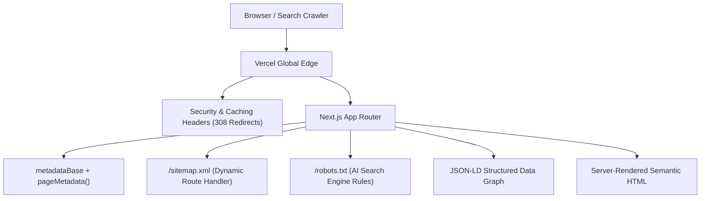

# Technical SEO Architecture & Verification Report

**Domain**: [https://shashankportfolio-jet.vercel.app/](https://shashankportfolio-jet.vercel.app/)  
**Framework**: Next.js 16.3.4 (App Router)  
**Hosting & CDN**: Vercel Global Edge Network  
**Report Date**: November 22, 2026  

---

## 1. Technical Architecture Overview

The portfolio's technical foundation was re-engineered to follow Google Search Central, Schema.org, and Next.js modern App Router best practices.



---

## 2. Google Search Console Verification

- **Token**: `googlebcc3fd247517937d`
- **Implementation in `app/layout.tsx`**:
  ```tsx
  export const metadata: Metadata = {
    metadataBase: new URL("https://shashankportfolio-jet.vercel.app/"),
    title: "Shashank Shinde Portfolio",
    verification: {
      google: "googlebcc3fd247517937d",
    },
    // ...
  };
  ```
- **Live Output Verified**:
  `<meta name="google-site-verification" content="googlebcc3fd247517937d"/>` rendered in the `<head>` of `https://shashankportfolio-jet.vercel.app/`.
- **Static File Backup Verified**:
  `https://shashankportfolio-jet.vercel.app/googlebcc3fd247517937d.html` returns `200 OK`.

---

## 3. Metadata & Canonical Uniformity

All pages utilize the unified metadata generator in `web/seo/site.ts`:

- **Site Name**: Exactly `Shashank Shinde Portfolio`.
- **Homepage Title**: `Shashank Shinde Portfolio`.
- **Inner Pages Pattern**: `[Page Name] | Shashank Shinde Portfolio`.
- **Canonical URLs**: Strictly absolute `https://shashankportfolio-jet.vercel.app/...` with self-referencing canonical tags on all indexable pages.
- **Indexability**: All 24 core pages set `robots: { index: true, follow: true, "max-image-preview": "large" }`. Only `/work` (the isolated Ability Card modal) sets `robots: { index: false, follow: true }`.

---

## 4. Redirect Engine (`next.config.mjs`)

Permanent HTTP 308 redirects are executed at the edge:

```javascript
async redirects() {
  return [
    { source: "/home", destination: "/", permanent: true },
    { source: "/web-developer", destination: "/automation-testing", permanent: true },
    { source: "/app-developer", destination: "/mobile-testing", permanent: true },
    { source: "/ui-ux-designer", destination: "/manual-testing", permanent: true },
    { source: "/graphic-designer", destination: "/api-testing", permanent: true },
    { source: "/photographer", destination: "/performance-testing", permanent: true },
  ];
}
```

---

## 5. Dynamic Sitemap (`app/sitemap.ts`)

- Dynamically iterates over all 24 public pages in `pages` dictionary.
- Emits XML with `lastModified`, `changeFrequency`, and `priority`:
  - Homepage: Priority 1.0 (weekly)
  - Case Studies: Priority 0.9 (monthly)
  - Core Hubs & Specialty Doors: Priority 0.85 (monthly)
  - Sub-Skills & Legal: Priority 0.75 (monthly)
- Verified active at `https://shashankportfolio-jet.vercel.app/sitemap.xml`.
